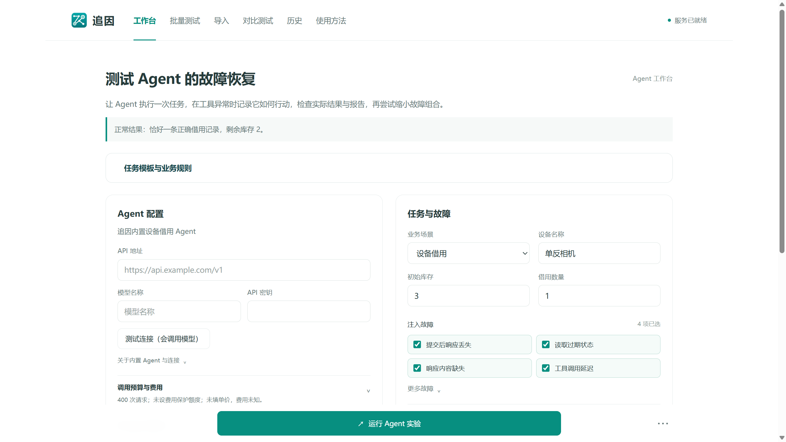

# 追因

## 面向业务智能体的故障复现与证据资格核验工具

2026“仓颉杯”智能编程大赛  创新原型赛道  
应用版本 v0.7.0  构建 45545df053be38b5fcfb  
参赛者为单人成员，身份信息以报名登记表为准。

工具调用超时或读到旧数据时，业务可能已经完成，Agent 看到的却是失败或空结果；它报告成功时，也未必有足够证据。追因把工具调用、数据库状态和最终报告放在同一条实验链中，便于回看和复核。

图 1  当前交付软件的内嵌工作台。模型配置、任务与故障、调用预算在同一界面中核对。

本版包含诊断定位、历史比较与选中重测、版本化任务模板，以及长摘要换行和导入详情独立显示两项修复。演示视频由参赛者亲自录制。

## 01 业务问题与功能闭环

追因面向需要测试工具调用与异常恢复的 Agent 开发者。以库存三台相机、借用一台为例：正常结果应是一条有效预约、库存剩两台；如果提交成功但响应丢失，再次提交就可能产生重复写入。

| 入口 | 操作与输出 |
| --- | --- |
| 工作台 | 配置模型服务、工具和完整指令；设置任务与故障，运行单次实验，保存执行轨迹、业务记录和报告核对。 |
| 批量测试 | CSV、JSON、JSONL 或 ZIP 先预览，检查重复与冲突；每个任务分别运行原始、仅幂等、仅核验、幂等＋核验四种防护。 |
| 导入 | 解析场景或日志，执行规则验证或静态分析；详情在导入页内只读打开，可返回原列表。 |
| 对比测试 | 选择策略、提示层和重复次数，在新业务环境中重复同一任务，分别统计业务与报告结果。 |
| 历史 | 只读查看和比较保存记录；可复制配置，或把选中任务生成新的重测预览。 |
| 使用方法 | 说明操作流程，并提供单次、批量和并发规则自检；固定规则检查不调用模型。 |

一轮任务可能多次请求模型。任务数、请求数和费用分别记录；预算用尽、停止、执行异常和未运行都会保留状态。

## 02 智能功能与创新设计

### 模型参与业务执行

内置 Agent 根据工具返回选择查询、写入、独立核验和最终报告。系统提供真实 SQLite 业务环境，可模拟响应丢失、过期读取、响应缺失、延迟、提交前超时、虚假回执和业务内容损坏。业务参数由系统按场景填入；模型参数抽取不在本版测试范围。

### 业务结果与报告依据分别判断

数据库是否完成、业务是否违规、报告与记录是否一致、报告能否确认，四项分别展示。工具报错只说明调用异常，业务结果以数据库记录为准；正确的拒绝和无法确认单独统计。模型报告作为被核对对象，数据库记录是业务判断的主依据。

### 从错误记录到受约束的故障精简

复现目标错误后，系统围绕同一错误指纹逐项删除故障并重复核验，保留每次尝试和停止原因。未复现错误时直接记录；精简结果只覆盖本次故障组合。

### 诊断定位与可复核证据

诊断把配置故障、实际触发事件、模型可见返回、保存的实际状态和最终业务记录连起来。点击发现可定位事件或记录，并给出规则生成的检查建议；最早异常作为线索，根因需结合后续证据判断。

### 创新与实用范围

重点在于把异常注入、业务裁判、报告核对、配对防护和证据回看组织成可运行闭环。当前支持小规模工具恢复实验、回归检查和材料复核；已验证内置设备借用与工单创建两个场景。

## 03 工程实现与本版改进

| 层次 | 主要实现 |
| --- | --- |
| 交互 | 原生 HTML / CSS / JavaScript；工作台、批量、导入、对比、历史及使用方法六个页面。 |
| 实验编排 | Python 标准库服务；Agent 工具循环、故障配置、预算与费用记录、批量和多轮任务。 |
| 业务与判定 | SQLite 写入与独立读取；分别保留业务违规、报告不一致、unknown、停止和未运行。 |
| 产品工作流 | 证据定位诊断、只读历史比较、重测预览、版本化任务模板和有限业务规则。 |
| 桌面交付 | PyInstaller 便携程序，Microsoft WebView2 内嵌窗口；本机回环服务和独立数据目录。 |

### 任务模板与历史复用

模板保存任务、故障、指令、预算和业务规则，不保存模型连接或密钥。每次运行保留模板版本快照；规则限于记录数量、指定字段和库存变化，不执行自定义 SQL 或代码。查看历史、比较结果和生成重测预览都不会自动发起新实验。

### 两项前端修复

模型、请求量和费用的长摘要按窗口宽度换行。导入批量结果的详情在导入页内独立打开，可返回原列表并恢复焦点，不再借用工作台或把结果混入使用方法。

### 软件与演示对应关系

视频演示当前主要流程，覆盖单次 Agent、批量、导入、重复对比、历史及规则自检；末尾展示任务模板区域，模板编辑和选中重测未在视频中完整操作。

## 04 验证结果及证据范围

### 当前软件构建的工程验证

| 检查 | 验证结果与范围 |
| --- | --- |
| 当前构建 45545… | 20 项便携检查；17 项实际 WebView2 窗口检查；57 项构建源文件哈希匹配。 |
| 导入详情修复 | 8 项浏览器交互通过；历史 26 项、工作台返回 14 项前端检查通过。 |
| 本次提交副本 | 51 个模块的可移植子集 573 项，58.619 秒，0 失败/错误/跳过；干净数据启动及 23 项静态资源核对通过。 |
| 前一文案阶段 6fb5… | 834 项全量测试，173.157 秒，0 失败/错误/跳过；11 组封装产品检查。本版未重新执行该全量测试。 |

### 已有真实模型研究独立保留

| 研究材料 | 观察与限制 |
| --- | --- |
| 30 次冻结状态判断 | 10 次结论正确且有证据支持，15 次合理保留，5 次证据充分但模型仍未确认；完整空快照后仍无法确认的情况保留。 |
| 24 次证据资格对照 | 有资格证据下 12 次结论正确且有证据支持，条件不足时 12 次合理保留；两协议最终判断相同，结构化有效引用可定位 0/12。 |

研究为有限场景观察，两个研究分别统计；冻结判断不执行恢复任务。研究结果在本说明中汇总，原始研究材料未随包提供；服务身份、作者和外部来源需另行确认。

## 05 评审路径与应用边界

建议先运行便携程序，查看模型、工具和故障设置，再观看作品演示；需要复核具体结论时，进入历史查看保存记录，或查看本说明中的研究汇总。报名登记表由参赛者单独准备，不混入软件目录。

| 视频时间 | 展示内容 |
| --- | --- |
| 00:00 - 01:40 | 工作台配置、完整工具定义、单次 Agent 运行、诊断与操作轨迹。 |
| 01:40 - 03:30 | 任务包预览、制作说明、四种防护的批量结果与逐项记录。 |
| 03:30 - 04:09 | CSV 导入、规则批量验证及只读场景详情。 |
| 04:09 - 05:32 | 重复次数与策略选择、四次任务、报告分布、调用量与费用估算。 |
| 05:32 - 06:10 | 历史记录读取与两次保存结果的配置比较。 |
| 06:10 - 06:43.7 | 操作说明、固定规则自检和首页收尾。 |

### 部署与使用价值

Windows 便携程序无需安装 Python；无需模型即可查看界面、下载模板、导入材料和运行规则检查。真实 Agent 需另行配置模型服务和额度。

### 当前限制

当前只支持内置设备借用/工单创建 Agent，不支持任意外部 Agent 自动接入。幂等和核验是可用能力，模型是否使用由 Agent 决定；业务内容损坏无法自动修复。历史条件不一致时，比较结果用于对照差异，因果判断需另设实验。

本包材料：项目说明、完整源码压缩包、可运行程序与部署说明、演示视频、第三方资源与贡献说明。

